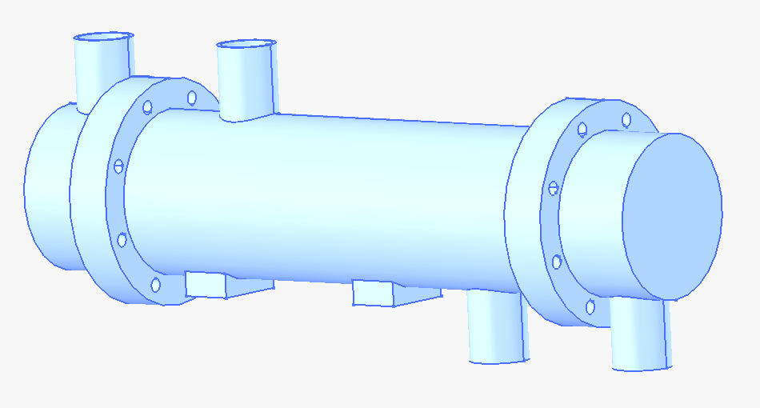
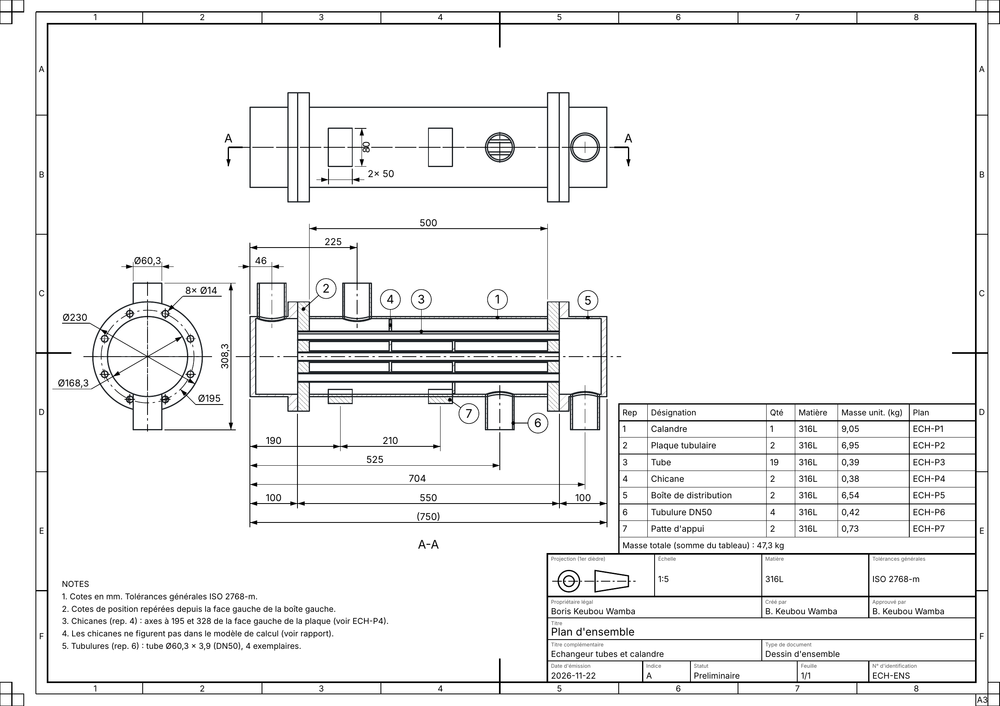

# Échangeur à tubes et calandre en 316L — CAO, plans, simulation FEM

Échangeur **à plaques tubulaires fixes** conçu sous FreeCAD 1.1.3, vérifié par éléments finis (CalculiX 2.23) sous pression et sous gradient thermique, avec plans normalisés ISO.

**Auteur** : Boris Keubou Wamba — M2 TMA, Grenoble.

*Modèle 3D (FreeCAD) : calandre, deux brides, quatre tubulures, deux pattes, boîtes d'extrémité.*

*Plan d'ensemble coté, A3, échelle 1:5, projection européenne (ISO 5457 / ISO 7200).*

## Résultats en bref

- **Thermique** : température moyenne des tubes 88,2 °C, identique à la solution analytique en résistances séries.
- **Pression** : contraintes de calandre et de virole à ±5 % de P·R/t ; fond plat entre les bornes encastré/appuyé.
- **Équilibre** : force axiale 12,4 kN retrouvée sur M3.
- **Dilatation différentielle** : tubes ≈ −54 MPa, calandre ≈ +45 MPa, inférieures aux bornes plaques rigides (−85 / +63 MPa) car les plaques fléchissent.
- **Marge indicative** (S = 133 MPa) : Pm max 17,5 MPa ; Pm+Pb+Q max 71,2 MPa sur le ligament de plaque.

> **Statut : étude préliminaire.** Les tubulures, la jonction tube/plaque et les pattes ne sont pas évaluées ; pas de congés, soudures, fatigue ni chicanes. Les critères de classification et S = 133 MPa sont indicatifs et à vérifier dans le code visé. Détails : [`docs/ANALYSE_RESULTATS.md`](docs/ANALYSE_RESULTATS.md).

## Contenu du dépôt

| Dossier | Contenu |
|---|---|
| `docs/THEORIE.md` | Objectifs, concepts physiques, résultats attendus |
| `docs/ANALYSE_RESULTATS.md` | Analyse des résultats FEM face aux lois physiques |
| `docs/RESULTATS_FEM.md` | Tableaux de résultats bruts, maillages, reproduction |
| `docs/GUIDE_PLANS.md` | Réalisation des plans TechDraw et gabarits |
| `fem/` | Scripts de charges, post-traitement, vérification analytique |
| `plans/` | Scripts TechDraw, gabarits SVG (A3, A4), génération du plan d'ensemble coté |
| `videos/` | Scripts de génération des vidéos (les vidéos sont dans les *Releases*) |
| `cao/` | Modèle FreeCAD (`.FCStd`) |
| `images/` | Images de ce README |

## Reproduire

1. Ouvrir le modèle FreeCAD dans `cao/`, maillage Gmsh, conditions limites : voir `docs/RESULTATS_FEM.md` §8.
2. Vérifier les ordres de grandeur : `python3 fem/verification_analytique.py` (aucune dépendance).
3. Plan d'ensemble : `python3 plans/plan_ensemble_cote.py <entrée.svg> <sortie.svg>`.

Les scripts FreeCAD contiennent le chemin `/CHEMIN/VERS/projet_echangeur` à remplacer par votre dossier local.

## Vidéos

Dans [`videos/`](videos/) (cliquer sur un fichier pour le lire dans GitHub) :

| Fichier | Contenu |
|---|---|
| [`00_assemblage_eclate.mp4`](videos/00_assemblage_eclate.mp4) | Assemblage éclaté |
| [`01_temperature_orbite.mp4`](videos/01_temperature_orbite.mp4) | Champ de température, vue en orbite |
| [`02_temperature_coupe.mp4`](videos/02_temperature_coupe.mp4) | Température sur un plan de coupe |
| [`03_vonmises_deformee.mp4`](videos/03_vonmises_deformee.mp4) | Contrainte de von Mises sur la déformée |

## Mise en données du modèle FEM

Figures dans [`docs/figures/`](docs/figures/) : demi-modèle, échangeur complet, symétrie, pattes, pressions et convection. 

## Licence

MIT, voir [`LICENSE`](LICENSE).

